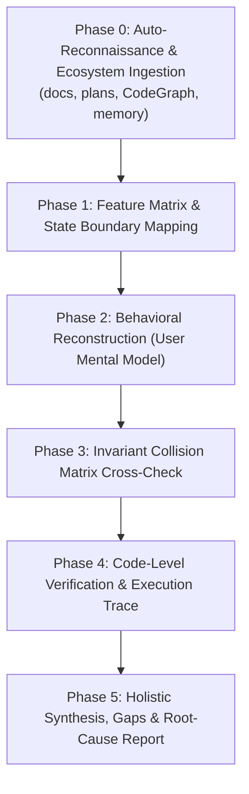

# Behavior-First Reverse Spec Debugging (Steve Ruiz Methodology)

> **Core Philosophy:** "Đừng bảo AI tìm lỗi. Hãy bắt nó mô tả toàn bộ trải nghiệm người dùng của sản phẩm."
> 
> Đánh giá mã nguồn thông thường (Code Review) thường bỏ sót các lỗi chỉ phát sinh khi nhiều tính năng độc lập, riêng lẻ đứng cùng nhau (ví dụ: *Crop + Rotate + Keyboard Move + Absolute/Local Coordinates*).
> Khi bắt AI tái cấu trúc toàn bộ "Luật chơi" (Mental Model & Invariant Rules) từ góc nhìn người dùng, sự mâu thuẫn giữa các luật sẽ làm lộ diện những lỗi tiềm ẩn sâu nhất (Emergent Bugs) và các điểm khuyết UX.

---

## ⚡ Kích Hoạt Tối Giản (Zero-Config Trigger)

Đại Ka chỉ cần gõ một câu ngắn gọn, không cần liệt kê từng file:

```text
Áp dụng skill behavior-model-debugger để audit toàn bộ trải nghiệm người dùng
```

Skill sẽ **tự động kích hoạt cơ chế Auto-Discovery** để đọc toàn bộ ngữ cảnh dự án trước khi phân tích.

---

## 🧭 Quy Trình Tự Động Hoàn Toàn (Autonomous 6-Phase Pipeline)



---

### Phase 0: Tự Động Trinh Sát & Nạp Ngữ Cảnh (Auto-Reconnaissance)

Khi nhận lệnh ngắn gọn, AI tự động quét dự án theo thứ tự ưu tiên:

#### 1. Đọc Ngữ Cảnh Dự Án (Project Context Ingestion)
- **Tài liệu & Kế hoạch:** Đọc `README.md`, `docs/`, `plans/`, `CONTEXT.md`, `PRD.md`, `walkthrough.md`, `tasks/`.
- **Lịch sử & Thay đổi gần đây:** Kiểm tra `git status`, `git log -n 5`, hoặc diff của nhánh hiện tại để biết tính năng nào vừa làm / đang làm dở dang.

#### 2. Tận Dụng Công Cụ Hệ Sinh Thái (Ecosystem Integration)
- **CodeGraph (Nếu có `.codegraph/`):**
  - Sử dụng tool `codegraph_explore` (hoặc CLI `codegraph explore`) để duyệt cây biểu đồ gọi hàm (Call graph), luồng điều phối sự kiện (Dynamic dispatch) và state transitions.
- **Claude-Mem / Memory Banks (Nếu có):**
  - Đọc `memory-bank/`, `.claude/memory/`, `activeContext.md` để nắm các quyết định kiến trúc trước đó.
- **GitNexus / Code Map:**
  - Định vị các module trung tâm (Core interaction engines, gesture controllers, event busses).

---

### Phase 1: Bóc Tách Ma Trận Tính Năng (Feature Matrix & Status)

Tổng hợp bức tranh toàn cảnh của sản phẩm/tính năng:
1. **Đã làm (Done):** Những tương tác đã hoàn thiện và chạy ổn.
2. **Đang làm (In-Progress):** Các luồng đang code dở hoặc vừa cập nhật.
3. **Thiếu gì / Cần gì (Gaps & Missing Invariants):** Các trường hợp biên chưa có code xử lý, thiếu feedback, thiếu rollback.

---

### Phase 2: Tái Tạo Mô Hình Hành Vi (Behavioral Reconstruction)

Đóng vai người dùng khó tính nhất. Tái hiện lại **toàn bộ tài liệu hành vi chi tiết** từ source code:

#### 1. Input & Modifiers (Bàn phím, Chuột, Cử chỉ)
- Hành vi cơ bản khi Click / Double-click / Right-click / Drag / Hover?
- Khi **giữ `Shift`**, hành vi đổi như thế nào? (Giữ tỉ lệ 1:1? Khóa trục snap 45°/90°? Multi-select range?)
- Khi **giữ `Ctrl` / `Cmd`**, hành vi đổi ra sao? (Bỏ snap? Zoom thay vì scroll? Duplicate drag?)
- Khi **giữ `Alt` / `Option`**, hành vi có chuyển sang tâm đối tượng (From center) hoặc pick màu không?
- Phím mũi tên (Arrow keys) dịch chuyển theo **Hệ tọa độ nào?** (World/Page coordinate tuyệt đối hay Local/Object coordinate đang xoay?)

#### 2. Interruptions & Lifecycle (Sự gián đoạn & Vòng đời)
- Nếu đang kéo (Drag) mà nhấn phím `Escape`, trạng thái có rollback sạch về trước khi kéo không?
- Nếu đang thao tác mà mất focus (`window.blur`, mở DevTools, Alt-Tab), app xử lý thế nào?
- Nếu người dùng thả chuột ra ngoài viewport / canvas, gesture có bị kẹt (stuck state) không?
- Nếu trigger Undo (`Ctrl+Z`) giữa lúc đang tương tác dở dang, chuyện gì xảy ra?

#### 3. State & Feedback (Trạng thái & Phản hồi giác quan)
- Con trỏ chuột (Cursor) có phản ánh đúng trạng thái tại mọi micro-state không?
- Khi xảy ra lỗi (Error/Fail), thông báo có rõ ràng, có prefix chuẩn (ví dụ: `Error: ...`), và có chỉ dẫn khắc phục không?
- Visual bounding box, guide lines, snap indicators có đồng bộ với góc xoay/crop/zoom hiện tại không?

---

### Phase 3: Ma Trận Va Chạm Luật Chơi (Invariant Collision Matrix)

Đặt các tính năng đơn lẻ vào thế đối đầu nhau trong bảng ma trận giao cắt:

| Tính năng A | Giao thoa với Tính năng B | Câu hỏi kiểm tra va chạm (Collision Question) |
| :--- | :--- | :--- |
| **Xoay (Rotate)** | **Dịch chuyển phím (Arrow Keys)** | Mũi tên Lên dịch chuyển lên phía trên màn hình hay lên theo đỉnh đối tượng đã xoay? |
| **Cắt (Crop)** | **Đổi kích thước (Resize/Scale)** | Resize khung crop hay resize nội dung bên trong? Tọa độ transform gốc có bị lệch? |
| **Group / Parent** | **Multi-selection Transform** | Khi xoay một nhóm gồm cả item đã xoay riêng lẻ, bounding box tính theo hệ nào? |
| **Snap to Grid** | **Zoom Level khác 100%** | Bước nhảy snap có bị giật hoặc sai số pixel khi zoom in/out không? |
| **Async Task** | **Context Compression / Cancel** | Nếu task nền thất bại, UI có báo lỗi hay im lặng treo loading? |

---

### Phase 4: Xác Minh Từng Dòng Code (Code-Level Verification)

Đối chiếu từng mâu thuẫn trực tiếp vào Source Code (Chống Hallucination):
1. **Truy vết biến đổi không gian (Transforms):** `localToWorld` hay `worldToLocal`, thứ tự nhân ma trận (`Translate -> Rotate -> Scale`).
2. **Truy vết Event Listeners & State Machine:** Cleanup listeners khi unmount / cancel, cờ boolean (`isDragging`, `isProcessing`).
3. **Kịch bản kiểm thử tái hiện (Reproduction Steps):** Từng bước click/phím cụ thể để chứng minh lỗi phát sinh.

---

### Phase 5: Báo Cáo Tổng Hợp Đa Tầng (Holistic Synthesis Report)

Xuất báo cáo toàn diện gồm cả **bức tranh toàn cảnh dự án** và **danh sách lỗi chi tiết theo Root Cause**.

---

## 📄 Output Template Chuẩn

```markdown
# 🔍 Behavioral Audit & UX Reconstruction: [Project / Feature Name]

## 1. 🌐 Tổng Quan Dự Án & Bức Tranh Tính Năng (Holistic Overview)
- **Dữ liệu đã quét:** `README.md`, `docs/`, `plans/`, `CodeGraph (.codegraph/)`, `Memory Bank`.
- **Tính năng Đã hoàn thiện (Done):** ...
- **Tính năng Đang phát triển (In-Progress):** ...
- **Lỗ hổng & Điểm thiếu (Gaps & Missing Requirements):** ...

## 2. 🎮 Tái Tạo Mô Hình Hành Vi Người Dùng (Reconstructed Behavioral Model)
- **Hành vi tương tác cơ bản:** ...
- **Tổ hợp phím Modifiers (`Shift` / `Ctrl` / `Alt`):** ...
- **Xử lý ngắt quãng (Escape, Blur, Cancel, Network Drop):** ...

## 3. 💥 Ma Trận Va Chạm Luật Chơi (Invariant Collision Matrix)
- [Va chạm 1]: Tính năng X vs Tính năng Y -> Phân tích điểm gãy.
- [Va chạm 2]: Hệ tọa độ Local vs World -> Phân tích điểm lệch.

## 4. 🚨 Lỗi Phát Hiện & Nguyên Nhân Gốc (Verified Root Causes)
### [Nhóm Lỗi] - [Tên lỗi ngắn gọn]
- **File & Line:** `path/to/file.ts:L123-L145`
- **Kịch bản Repro:** 1. ... -> 2. ... -> 3. ...
- **Nguyên nhân gốc:** ...
- **Đề xuất khắc phục:** ...

## 5. 💎 Danh Sách Nâng Cấp Độ Mượt (Ergonomics & Polish Checklist)
- [ ] [Cải thiện 1: Con trỏ chuột / Phản hồi visual]
- [ ] [Cải thiện 2: Chuẩn hóa thông báo lỗi]
```

---

## 🛡️ Cổng Kiểm Toán Độ Hoàn Thiện Thực Chứng (Empirical Parity Gate)

Khi thẩm định độ tương đồng (Parity Audit) giữa ứng dụng gốc (Decompiled Blueprint) và ứng dụng Clean Native MVP:
1. **Nghiêm cấm nhận vơ tỷ lệ 90-99% (Anti-Sycophancy Rule):** Tuyệt đối không được báo cáo "đạt 90-99%" nếu chỉ mới chạy được một số tính năng cốt lõi (Core Tracer Bullet). 
2. **Khảo sát tài nguyên tĩnh toàn diện (Static Asset Manifest):** Bắt buộc quét toàn bộ folder `assets/`, `res/drawable/` của bản gốc để phát hiện các tính năng còn ẩn giấu (như `sellos_color` = Stickers, `crayons` = Brush textures, `btn_music_on` = BGM loop, `btn_save` = Export Gallery).
3. **Phân cấp 3 bậc Parity rõ ràng:**
   - **Level 1 (Core Tracer Bullet - 70-75% Parity):** Luồng chính chạy được (Canvas vẽ, Flood Fill, Palette cơ bản, Back/Clear).
   - **Level 2 (Enhanced MVP - 85-92% Parity):** Đầy đủ các công cụ tương tác con (Glitter brush, Stickers tray, Brush stroke widths, Bảng màu 24+ cuộn ngang, BGM loop).
   - **Level 3 (Full Commercial Parity - 98-100% Parity):** Lưu kiệt tác vào Album "Tranh của bé", chia sẻ, frame trang trí, animations chúc mừng khi hoàn thành tranh (`very_good2_*.png`), pinch-to-zoom xoay lật.
4. **Cảnh Giác Super-App Scope (App Gốc Đội Lốt Mini-Game Suite):**
   - Nhiều game trẻ em 2D trên Store (như Orange Studios, RV AppStudios) thực chất là **Super-App** gói hơn 10-15 mini-games khác nhau (`firework`, `piano`, `drums`, `jigsaw`, `bubble_wrap`, `pixel_art`) vào cùng một APK.
   - Bắt buộc phải bóc tách rành mạch:
     + **Core Module Parity (Độ tương đồng phân hệ mục tiêu):** Ví dụ Phân hệ Sách Tô Màu Công Chúa (`Princess Coloring Book`) đã đạt 98% tính năng.
     + **Full Suite Scope (Toàn bộ hệ thống mini-game):** Đánh giá rõ các mini-games phụ trợ chưa chuyển đổi, tránh gây hiểu nhầm giữa "xong phân hệ MVP" và "làm lại toàn bộ 15 trò chơi của app gốc".

---

## 🚫 8. Cổng Kiểm Toán Nối Dây Giải Thuật Thực Chất (Decorative Mock vs End-to-End Pipeline Wiring Audit Gate)

> **Cảnh báo Blind Spot nguy hiểm nhất của AI Coding:** Viết thuật toán rất xịn (`*Engine.kt`), vượt qua 100% JVM Unit Tests, nhưng khi gắn vào giao diện Composable thì lại **NỐI TẮT MOCK DỮ LIỆU** (ví dụ: gán Before và After cùng trỏ vào 1 URI ảnh gốc, hoặc nút Xóa vật thể chỉ đổi biến boolean để tráo 2 ảnh tĩnh drawable thay vì chạy giải thuật Inpaint trên nét vẽ thật của người dùng).
> 
> Giao diện chụp màn hình nhìn qua tưởng như đã hoàn hảo 95%, nhưng thực chất là một **"Mô Hình Rỗng (Potemkin Village / Decorative Mock)"**.

### Quy Chuẩn Kiểm Toán Bắt Buộc (Mandatory Pipeline Checklist):
1. **Kiểm tra luồng xử lý ảnh/video (Media Pipeline Integrity):**
   - Người dùng chọn ảnh (Photo Picker) hoặc chụp Camera ➔ Bắt buộc giải mã thành `Bitmap` thật.
   - Nút "Nâng cấp" hoặc thanh so sánh Before/After ➔ Bắt buộc truyền `Bitmap` gốc qua `ImageProcessingEngine` để sinh ra `enhancedBitmap` thật sự (có sự khác biệt rõ rệt về độ sắc nét, histogram màu, micro-contrast).
   - Thanh trượt Split Slider ➔ Bắt buộc hiển thị bên trái là ảnh gốc, bên phải là `enhancedBitmap` đã qua xử lý.
2. **Kiểm tra luồng xóa vật thể (Object Eraser Pipeline Integrity):**
   - Nét cọ người dùng vẽ trên Canvas (`Path`) ➔ Bắt buộc được rasterize thành mặt nạ nhị phân (`BooleanArray` hoặc Mask Bitmap).
   - Nút "Xóa vật thể" ➔ Bắt buộc gọi thuật toán Inpainting nội suy các pixel xung quanh để lấp đầy vùng chọn, xuất ra Bitmap kết quả mới hiển thị lên màn hình. Cấm tuyệt đối tráo drawable ID có sẵn.
3. **Kiểm tra luồng lưu trữ phần cứng (Hardware Persistence Integrity):**
   - Nút "Lưu ảnh" ➔ Bắt buộc ghi file thật vào bộ sưu tập (`MediaStore.Images.Media.insertImage` hoặc thư mục `Pictures`), xuất URI hợp lệ và thông báo đường dẫn lưu file cụ thể. Cấm chỉ hiển thị Toast thông báo suông.
4. **Kiểm tra nguồn cấp dữ liệu (CDN Asset Fallback Integrity):**
   - Khi tham chiếu dữ liệu từ `homedata.json` của app gốc, hỗ trợ tải trực tiếp qua CDN URLs (Coil/Glide) khi có mạng, đồng thời cung cấp bộ asset cục bộ (`res/drawable/`, `assets/`) làm fallback offline, chống sập app khi mất kết nối.

---

## ⚖️ 9. Cổng Kiểm Toán Bản Quyền Tài Nguyên & Lỗ Hổng Hotlink (Zero-DMCA & Anti-Hotlink Audit Gate)

> **Mục tiêu:** Triệt tiêu hoàn toàn nguy cơ bị Google Play trảm do vi phạm DMCA hoặc sập app do server đối thủ ngắt kết nối.

### Bộ Quy Tắc Thẩm Định Khắt Khe (Zero-Tolerance Checklist):
1. **Kiểm toán Font chữ (Font IP Audit):**
   - Quét toàn bộ thư mục `assets/` và `res/font/`: **CẤM HOÀN TOÀN** sự hiện diện của các file font trích xuất trực tiếp từ APK gốc.
   - Chỉ chấp nhận các bộ font chuẩn Google Fonts mã nguồn mở (OFL License) đã được khai báo rõ ràng.
2. **Kiểm toán Tầng lưu trữ Asset (Two-Tier Separation Audit):**
   - Kiểm tra cấu hình `build.gradle.kts` (SourceSets): Đảm bảo `assets_blueprint/` bị loại bỏ 100% trong `release` build.
   - Kiểm tra `ASSET_MANIFEST.md`: Xác nhận không còn file nào mang cờ `TEMPORARY` trước khi đóng gói Release.
3. **Kiểm toán Điểm nóng Hotlink (Hotlink Zero-Leak Audit):**
   - Quét tìm trong mã nguồn các URL trỏ trực tiếp đến Domain/API/CDN của bên thứ ba không sở hữu:
     ```powershell
     # Script tự động rà soát chuỗi URL khả nghi trong code Kotlin
     Select-String -Path "app/src/**/*.kt" -Pattern 'https?://[^\s"]+' | Where-Object { $_.Line -notmatch "schemas.android.com|www.w3.org" }
     ```
   - Nếu phát hiện gọi trực tiếp API động có kèm token hoặc cookie của app gốc: **FAIL NGAY LẬP TỨC**. Bắt buộc chuyển đổi sang mô hình `Snapshot Seeder` lưu trong `seed_data/`.

---

## 🏛️ 10. Cổng Kiểm Toán Tuân Thủ Google Play Store & Tính Toàn Vẹn AAPT2 (Store Ban & AAPT2 Audit Gate)

> **Mục tiêu:** Đảm bảo ứng dụng khi tải lên Google Play Console không bị từ chối phát hành (Rejection) hoặc bị quét đình chỉ tài khoản Developer (Account Ban).

### Quy Chuẩn Kiểm Tra Thép:
1. **Kiểm tra cú pháp đặt tên AAPT2 (AAPT2 Naming Syntax Check):**
   - Quét toàn bộ file trong `res/` và `assets/`.
   - Nếu phát hiện bất kỳ file nào chứa chữ in hoa (`[A-Z]`), dấu gạch ngang (`-`), hoặc khoảng trắng: **FAIL NGAY LẬP TỨC**.
2. **Kiểm tra chuẩn Target SDK (Google Play Annual Policy Check):**
   - Kiểm tra `app/build.gradle.kts`: `targetSdk` bắt buộc phải >= 34 (Android 14+). Cấm để các SDK lỗi thời khiến Console từ chối nhận AAB.
3. **Kiểm tra quyền hạn & giải trình (Permissions & Data Safety Pre-Flight):**
   - Đối chiếu danh sách `<uses-permission>` trong `AndroidManifest.xml`.
   - Nếu có quyền `QUERY_ALL_PACKAGES` hoặc `SYSTEM_ALERT_WINDOW`, kiểm tra xem code có màn hình giải trình người dùng không. Nếu không cần thiết, tự động loại bỏ.
4. **Kiểm tra luồng thanh toán (Billing Compliance):**
   - Quét mã nguồn tìm các từ khóa thanh toán lậu (`vietqr`, `sepay`, `momo`, `bank transfer`, `stripe webview`).
   - Mọi tính năng thu phí (PRO/VIP) trên bản Store bắt buộc phải tích hợp Google Play Billing Library chính thức.


