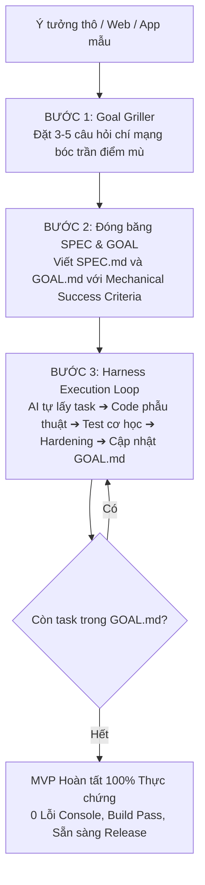

# Harness Engineering Master Skill

Bộ khung chuẩn hóa quy trình phát triển phần mềm và xây dựng MVP với AI Coding Agent (dựa trên triết lý `repository-harness`, Progressive Disclosure, Goal Griller, Karpathy Guidelines và ai-copilot-alignment).

---

## 1. Triết lý cốt lõi: Dây cương (Harness) cho AI Agent

Coding Agent thất bại không phải vì mô hình kém thông minh, mà vì thiếu **Bộ khung kiểm soát (Engineering Harness)**:
1. **Repository là Hệ quy chiếu Tối thượng (System of Record):** Mọi quyết định, đặc tả, mục tiêu, mã nguồn và chứng cứ kiểm thử phải nằm trong file Git, không nằm rải rác trong cửa sổ chat vốn sẽ bị trôi mất (ephemeral context).
2. **Progressive Disclosure (Phơi bày ngữ cảnh có kiểm soát):** Không nhồi hàng trăm nghìn dòng code vào context. AI chỉ đọc tài liệu thẩm quyền liên quan trực tiếp đến tác vụ hiện tại (`AGENTS.md` ➔ `docs/WORKFLOW.md` ➔ `SPEC.md` ➔ `GOAL.md`).
3. **Ranh giới thẩm quyền (Authority Boundary):** AI tuyệt đối KHÔNG tự ý suy diễn chính sách sản phẩm (Product Policy). Nếu có điểm mơ hồ (ambiguity), AI bắt buộc phải dừng lại và hỏi người dùng trước khi sửa code.
4. **Mechanical Validation (Kiểm chứng cơ học):** Báo cáo hoàn thành bằng lệnh terminal (exit code 0, typecheck pass, test pass, curl 200), không nghiệm thu bằng lời nói suông ("em làm xong rồi").
5. **Chống lệch tài liệu (Anti Doc-Drift):** Khi code thay đổi, tài liệu `GOAL.md` và `docs/plans/` phải được cập nhật đồng bộ.

---

## 2. Bản đồ tài liệu chuẩn trong Repository

Một repository chuẩn Harness Engineering bao gồm các thành phần sau:

```text
├── AGENTS.md                   # Cổng vào đầu tiên cho mọi AI Agent, ranh giới thẩm quyền
├── SPEC.md                     # Đặc tả kỹ thuật & nghiệp vụ, kiến trúc, non-goals
├── GOAL.md                     # Mục tiêu tổng thể, chia milestones kèm Success Criteria
├── docs/
│   ├── WORKFLOW.md             # Quy tắc tương tác, phân loại task (Read-only vs Bounded vs Multi-session)
│   ├── templates/
│   │   └── exec-plan.md        # Mẫu kế hoạch thực thi chi tiết cho các task lớn
│   └── plans/
│       ├── active/             # Các kế hoạch đang thực thi
│       └── completed/          # Các kế hoạch đã hoàn thành kèm bằng chứng kiểm thử
└── .agents/
    └── skills/                 # Skills chuyên biệt ở cấp độ dự án (Project Scope)
```

---

## 3. Quy trình 3 bước từ Ý tưởng ➔ MVP Hoàn thành



### Bước 1: Goal Griller Protocol (Phỏng vấn phản biện)
Trước khi gõ một dòng code nào, AI đóng vai **Lead Architect / Goal Griller** khó tính, đặt 3-5 câu hỏi xoáy vào:
- **Giả định ngầm (Hidden Assumptions):** Những điều người dùng tưởng là hiển nhiên nhưng hệ thống chưa có.
- **Ranh giới nghiệp vụ (Non-Goals):** Tính năng nào tuyệt đối KHÔNG làm trong MVP này để tránh bành trướng phạm vi (scope creep).
- **Rủi ro kỹ thuật & Rào cản tích hợp:** Auth, database, third-party API limits, CORS, payment webhook.

### Bước 2: Thiết lập `SPEC.md` và `GOAL.md`
- **`SPEC.md`:** Khóa kiến trúc, Tech Stack, Database Schema, API Contracts, UI/UX Rules.
- **`GOAL.md`:** Chia lộ trình thành các Milestones rõ ràng. Mỗi Milestone bắt buộc phải có:
  - Danh sách task nhỏ (Atomic Tasks).
  - **Mechanical Success Criteria:** Câu lệnh cụ thể để AI tự chạy xác minh (Ví dụ: `pnpm tsc --noEmit`, `curl -I http://localhost:3000/api/health`, `pnpm test`).

### Bước 3: Harness Autonomous Loop (Vòng lặp tự hành)
1. **Lấy task:** Đọc task chưa hoàn thành tiếp theo trong `GOAL.md`.
2. **Surgical Coding:** Sửa đúng chỗ, tuân thủ Karpathy Guidelines (không over-engineer, không viết code thừa).
3. **Mechanical Verification:** Tự chạy lệnh kiểm tra. Nếu thất bại, tự đọc stack trace và tự sửa. TUYỆT ĐỐI không gọi người dùng test tay.
4. **Hardening:** Thêm rào chắn chống lỗi biên (edge cases, invalid inputs, error handling).
5. **Cập nhật trạng thái:** Đánh dấu `[x]` vào `GOAL.md` kèm ghi chú bằng chứng. Lặp lại cho task tiếp theo.

---

## 4. Lệnh khởi tạo nhanh (Bootstrap Harness)

Chạy script Python đi kèm để tự động sinh toàn bộ bộ khung Harness vào repository hiện tại (tự động tương thích cả Windows và macOS/Linux):

- **Trên Windows (PowerShell):**
  ```powershell
  python "$HOME/.gemini/config/skills/harness-engineering/scripts/init_harness.py"
  ```
- **Trên macOS / Linux:**
  ```bash
  python3 ~/.gemini/config/skills/harness-engineering/scripts/init_harness.py
  ```
- **Hoặc chạy trực tiếp từ thư mục skill:**
  ```bash
  python scripts/init_harness.py
  ```
Script sẽ tự động tạo `AGENTS.md`, `docs/WORKFLOW.md`, `docs/templates/exec-plan.md`, `SPEC.md` (draft), `GOAL.md` (draft) và `.agents/skills/` phù hợp với Tech Stack hiện tại.
